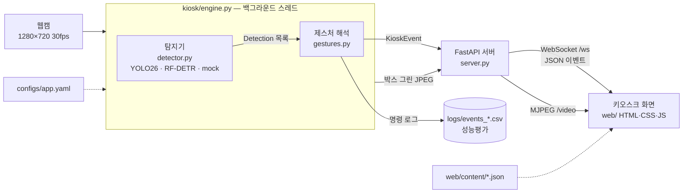

# 03. 시스템 구성 & 파트 간 약속

## 1. 시스템 구성도



**1프레임 처리 순서**: 카메라 프레임 → 탐지(손 박스 + 제스처 클래스) → 활성 손 선택 → 다수결 안정화 → 커서/클릭/스와이프/유지 판정 → WebSocket 으로 화면에 전달 → 화면이 커서 그리기·버튼 실행

## 2. 파트 경계

| | 🅐 모델 | 🅑 서비스 |
|---|---|---|
| 입력 | HaGRID 이미지·주석 | `Detection` 목록 |
| 출력 | 가중치 파일 (`models/*.pt`) + 성능 수치 | 화면 동작 + 명령 인식률 |
| 주로 수정 | `training/`, `data/`, `models/README.md` | `kiosk/gestures.py`, `kiosk/engine.py`, `kiosk/server.py`, `web/` |
| 공동 | `kiosk/detector.py`, `configs/app.yaml` 의 `detector:` | |

🅑 는 mock 모드(마우스·키보드)로, 🅐 는 `evaluate.py` 로 **서로 기다리지 않고** 개발합니다.

## 3. 약속 ① — 탐지 결과 형식 (`kiosk/gestures.py`)

```python
@dataclass
class Detection:
    label: str                              # 클래스 이름 (아래 ②)
    conf: float                             # 0~1
    box: tuple[float, float, float, float]  # (x1, y1, x2, y2), 이미지 크기로 나눈 0~1 정규화
```
- 좌표는 **원본 카메라 프레임 기준** (좌우 반전 전). 반전은 `gestures.py` 가 처리
- 모든 탐지기는 `detect(frame_bgr: np.ndarray) -> list[Detection]` 를 제공

## 4. 약속 ② — 클래스 이름

| id | 이름 | 의미 | 키오스크 역할 |
|---|---|---|---|
| 0 | `one` | 검지 | 커서 |
| 1 | `fist` | 주먹 | 클릭 (one → fist) |
| 2 | `palm` | 손바닥 | 스와이프 |
| 3 | `like` | 엄지 위 | 확인 |
| 4 | `dislike` | 엄지 아래 | 뒤로 |
| 5 | `peace` | 브이 | 처음으로 |
| (6) | `no_gesture` | 제스처 아닌 손 | 무시 (선택: 오탐 감소용으로 학습) |

- 이름이 다른 모델(예: HaGRIDv2 `point`)은 `configs/app.yaml` → `detector.label_map: {point: one}`
- 역할 매핑은 `gesture.pointer_labels / grab_labels / swipe_labels / hold_commands` 로 변경 가능

## 5. 약속 ③ — WebSocket 이벤트 (서버 → 화면, JSON)

| type | 필드 | 발생 조건 | 화면 동작 |
|---|---|---|---|
| `status` | backend, camera, fps, latency_ms, frames, gesture, hands | 0.5초마다 | 상단 상태 표시 |
| `cursor` | x, y (0~1), gesture, conf | 안정된 제스처가 `one` | 커서 이동 + 버튼 hover + dwell 링 |
| `click` | x, y, gesture | `one` → `fist` 0.8초 이내 | 커서 아래 버튼 실행 |
| `swipe` | direction: `left`/`right` (사용자가 보는 화면 기준 손 이동 방향) | `palm` 가로 이동 | left = 다음, right = 이전 |
| `hold` | gesture, progress (0~1) | like/dislike/peace 유지 중 | 게이지 표시 |
| `confirm` / `back` / `home` | gesture | 유지 0.7초 완료 | 확인 / 뒤로 / 처음 |
| `hand_lost` | — | 손이 1초 이상 안 보임 | 커서 숨김 |

## 6. HTTP 엔드포인트

| 경로 | 설명 |
|---|---|
| `GET /` | 키오스크 화면 |
| `GET /api/content` | 콘텐츠 JSON |
| `GET /api/status` | 엔진 상태 |
| `GET /video` | 카메라 미리보기 (MJPEG, 박스·FPS 표시) |
| `WS /ws` | 이벤트 스트림 |

## 7. 설정값 (`configs/app.yaml` → `gesture:`) 요약

| 키 | 기본값 | 의미 | 올리면 |
|---|---|---|---|
| `min_conf` | 0.5 | 탐지 신뢰도 하한 | 오탐↓ 누락↑ |
| `min_hand_area` | 0.004 | 손 박스 최소 면적 | 먼 사람 무시↑ |
| `vote_window` / `vote_min` | 5 / 3 | 다수결 | 안정↑ 반응 느려짐 |
| `cursor_alpha` | 0.35 | 커서 평활화 | 반응↑ 떨림↑ |
| `active_region` | [0.15,0.10,0.85,0.80] | 손 움직임 영역 → 화면 전체 | 좁히면 적게 움직여도 됨 |
| `click_window_s` | 0.8 | one→fist 허용 시간 | 클릭 쉬움↑ 오클릭↑ |
| `swipe_min_dx` / `swipe_max_dy` | 0.18 / 0.12 | 스와이프 거리 / 세로 허용 | |
| `hold_s` | 0.7 | 유지형 명령 시간 | 오발동↓ 느려짐 |
| `cooldown_s` | 0.9 | 명령 후 재발생 차단 | 연속 오발동↓ |
